 \newpage

# Methods
## Table 1. Indicator categories (general)

```{r}
#| label: fig-obj0-indicator_list
#| fig-cap: "Indicators and subguilds."
#| fig-align: center
#| fig-pos: "H"
#| out-width: "80%"
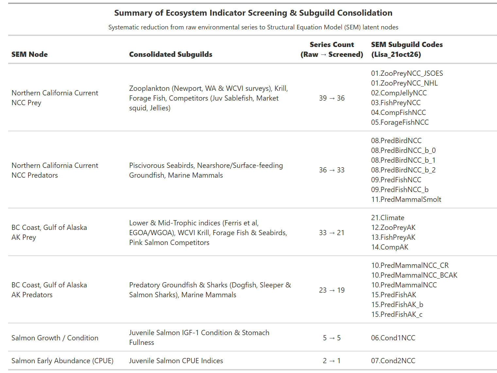
```
  

\newpage

## Figure 1: DAGS

```{r}
#| label: fig-obj0-dag1ABC
#| fig-cap: "DAGs used in analysis."
#| fig-align: center
#| fig-pos: "H"
#| out-width: "80%"
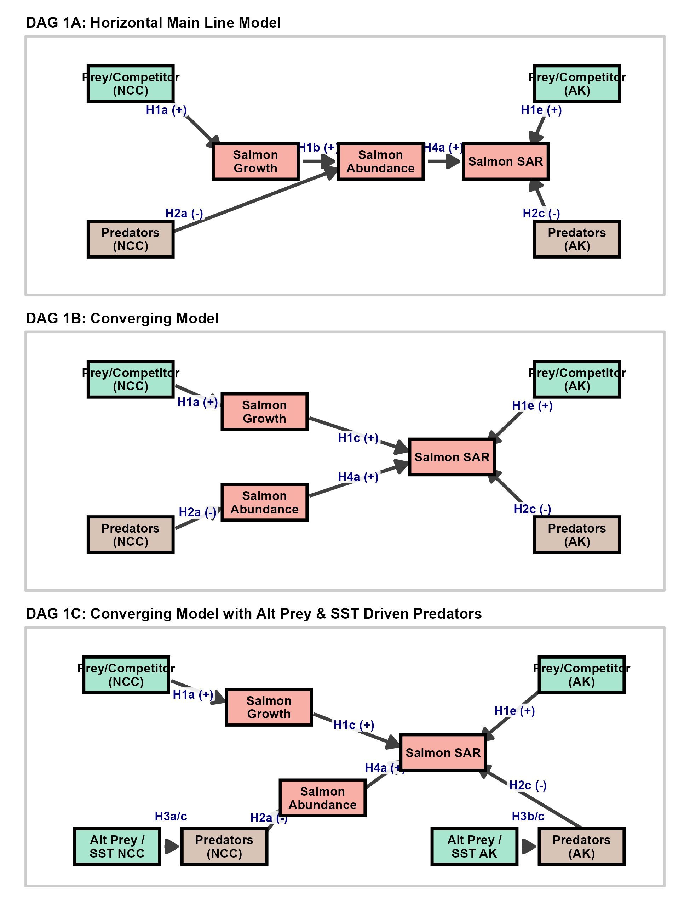
```
  
\newpage

## Table 2. Hypotheses 

```{r}
#| label: fig-obj0-hypotheses
#| fig-cap: "Hypotheses labeled in Figure 1."
#| fig-align: center
#| fig-pos: "H"
#| out-width: "80%"
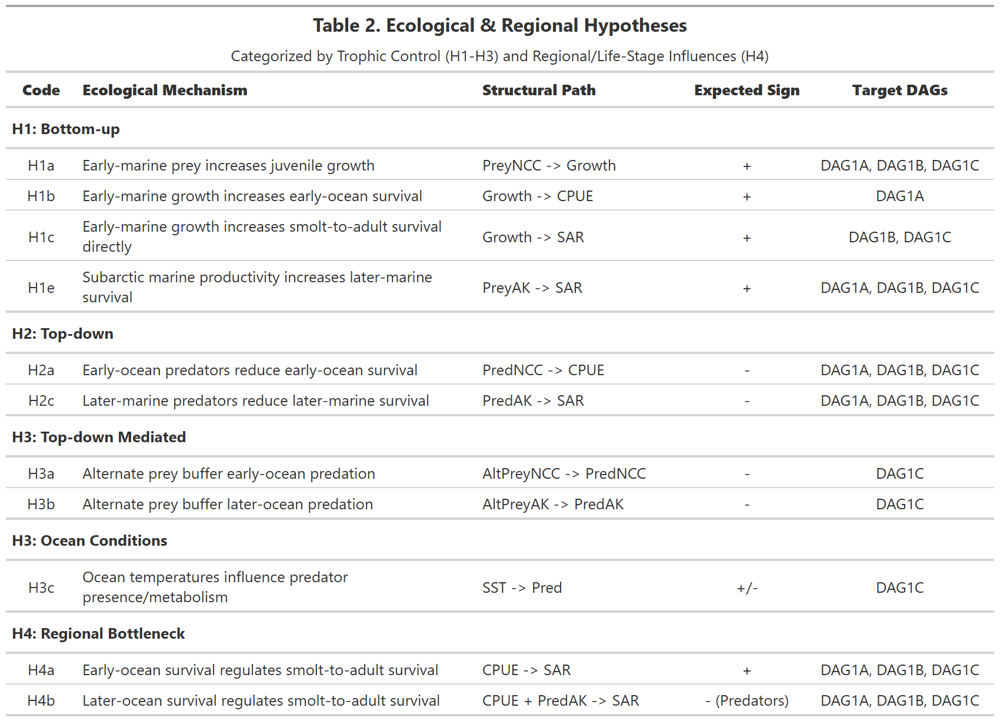
```
  
\newpage

# Objective 1: Resolution of topology --early vs late growth effects

## Table 3: DAG1B aic <= DAG1A -- supports later effects of growth over early effects
Relative variable importance ($w_i$) across all ecosystem indicators meeting the $\max(w_i) \ge 0.05$ threshold, comparing sequential mediation (DAG 1A) and direct growth mediation (DAG 1B) topologies across the 24-year complete dataset and 19-year expanded series.

```{r}
#| label: fig-obj1-dag1AvB
#| fig-cap: "Comparison of Top 10 Models: DAG 1A vs. DAG1B."
#| fig-align: center
#| fig-pos: "H"
#| out-width: "80%"
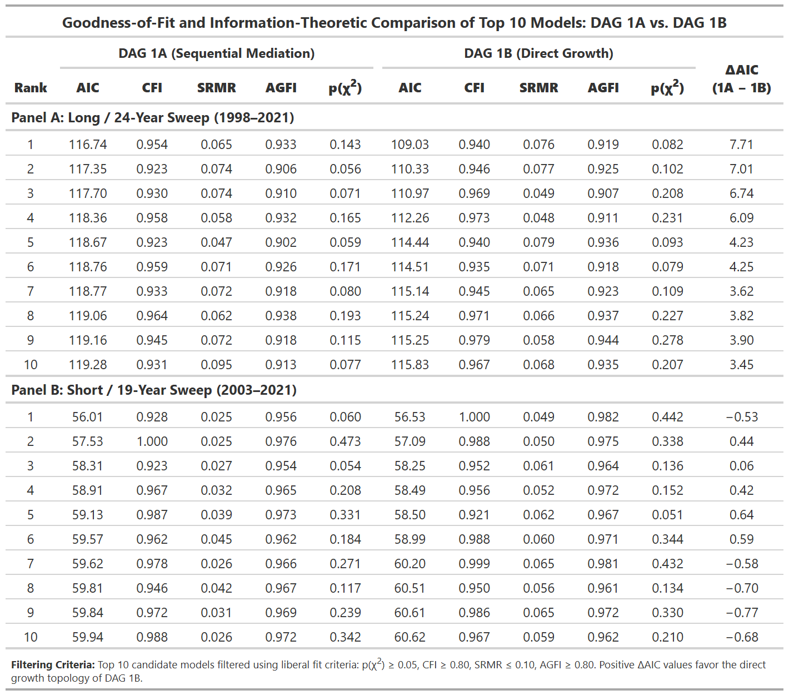
```
  
\newpage


## Table 4: Consistency of coefficient sign and significance with hypothesized mechanisms

```{r}
#| label: fig-obj1-hypotests
#| fig-cap: "Consistency of coefficient sign and significance with hypothesized mechanisms."
#| fig-align: center
#| fig-pos: "H"
#| out-width: "80%"
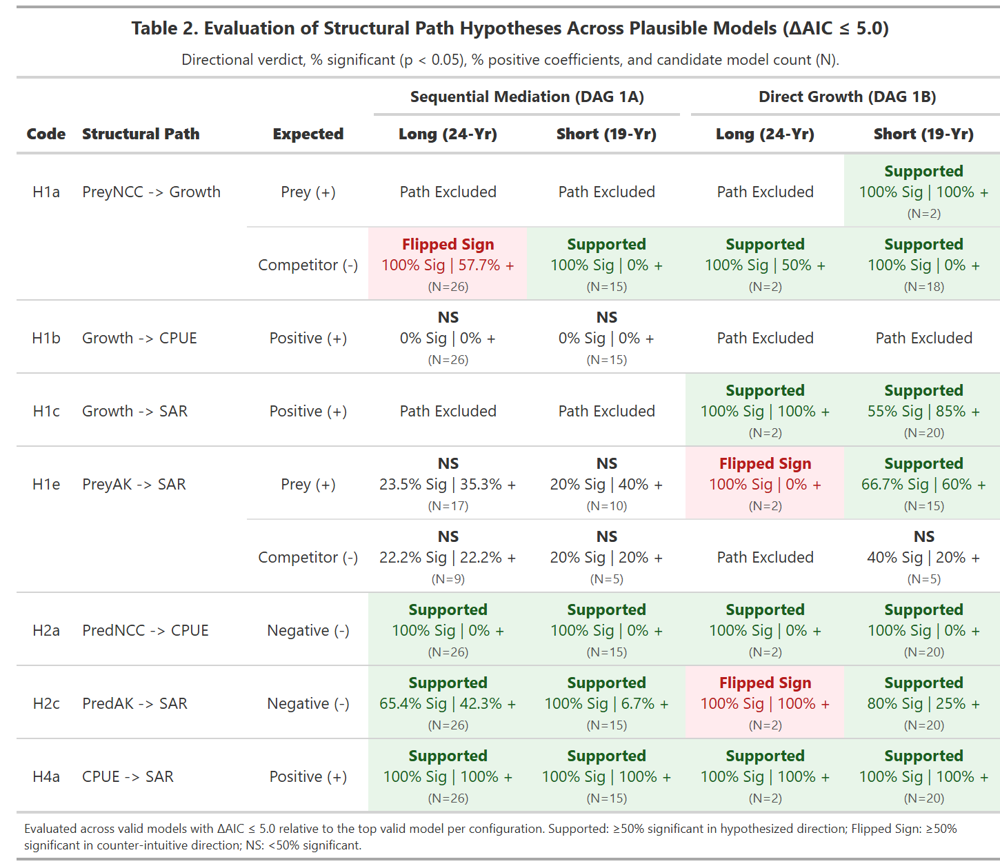
```
  
\newpage

# Objective 2: Ecosystem Drivers Supported Via Variable Importance

Overview
Model selection across candidate single-indicator structural equation models (SEMs) evaluated the relative influence of coastal Northern California Current (NCC) and Gulf of Alaska (AK) drivers on early marine survival (SAR). Multi-model inference via Akaike weights ($w_i$) was calculated across all statistically valid models ($p(\chi^2) \ge 0.05$, $\text{CFI} \ge 0.80$, $\text{SRMR} \le 0.10$, $\text{AGFI} \ge 0.80$) following baseline exclusions (`sablefishAK_biomass4plus` and `pollockGOA_SSB_lag1`).

## Figure 1: Relative Variable Importance across Ecosystem Indicators
Relative variable importance ($w_i$) across all ecosystem indicators meeting the $\max(w_i) \ge 0.05$ threshold, comparing sequential mediation (DAG 1A) and direct growth mediation (DAG 1B) topologies across the 24-year complete dataset and 19-year expanded series.

```{r}
#| label: fig-obj2-importance
#| fig-cap: "Relative variable importance (Akaike weights) across candidate functional ecosystem indicators."
#| fig-align: center
#| out-width: "100%"
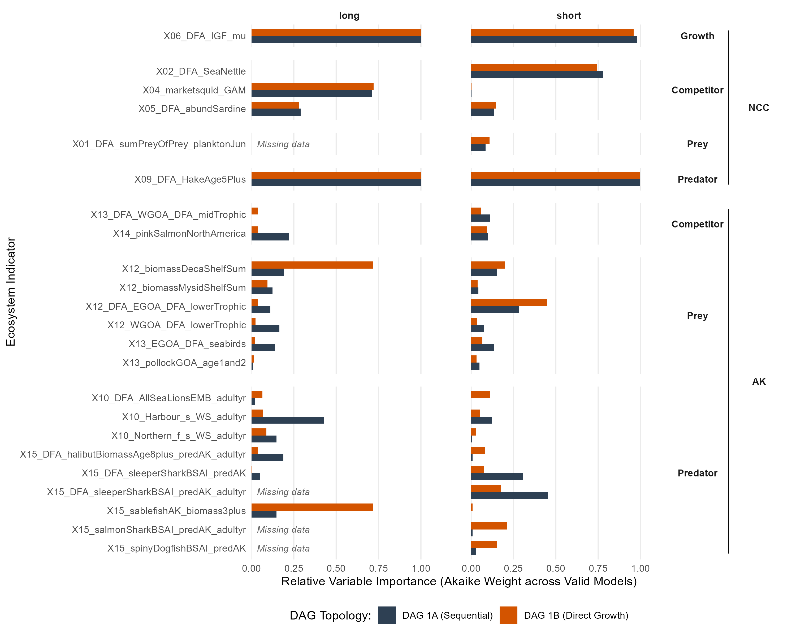
```


\newpage


# Objective 3: Direct vs. Modulated Predation Topologies

## Overview
To address counter-intuitive positive relationships between raw predator abundance and salmon survival, candidate predators were evaluated under an effective predation framework ($P_{\text{eff}}$):
  $$P_{\text{eff}} = P_{\text{norm}} \cdot \text{SST}_{\text{gate}} \cdot (1 - \text{AltPrey}_{\text{gate}})$$
  where thermal spatial overlap ($\text{SST}$) and alternative forage buffering ($\text{AltPrey}$) were scaled with a 0.2 baseline floor to prevent complete zero-multiplication.

## Table 3: Effective Predation ($P_{\text{eff}}$) Model Comparisons
Comparison of nominal predator biomass models versus top-ranked modulated $P_{\text{eff}}$ formulations. Shaded green cells indicate models where thermal gating and/or alternative prey buffering restored ecologically coherent top-down control ($\beta < 0$, $p \le 0.05$) with substantial AIC improvement ($\Delta\text{AIC} \le -2.0$).


```{r}
#| label: fig-obj3-peff
#| fig-cap: "Modulation of marine predator exposure"
#| fig-align: center
#| fig-pos: "H"
#| out-width: "80%"
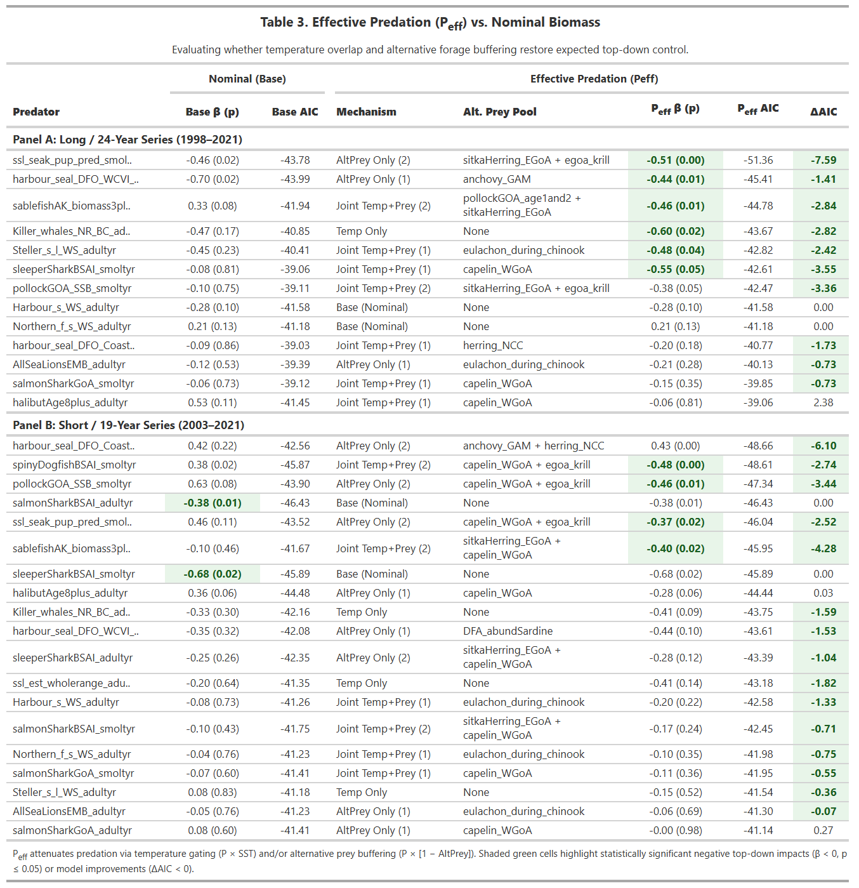
```
\newpage

# Objective 4: Multi-Basin Life-Stage Bottlenecks

## Overview
The life-stage hypothesis ladder was tested sequentially across the 24-year dataset (1998–2021) to evaluate the spatial and temporal bounds of survival bottlenecks. Note that avian predation and tailrace predation were padded to extend last and first years, i.e., 2019-2021 bird pred = 2018, and 1998-1999 tailrace predation = 2000. Bottlenecks compared:
  
  1. **Single-Arena (Early Marine NCC Only):** $\text{SAR} \sim \text{Growth}_{\text{NCC}} + \text{CPUE}_{\text{NCC}}$
  2. **Dual-Arena (+ Subarctic Alaska Marine):** $\text{SAR} \sim \text{Growth}_{\text{NCC}} + \text{CPUE}_{\text{NCC}} + \text{Prey}_{\text{AK}} + P_{\text{ocean\_eff}}$
  3. **Triple-Arena (+ Adult Columbia River Pinnipeds):** $\text{SAR} \sim \text{Growth}_{\text{NCC}} + \text{CPUE}_{\text{NCC}} + \text{Prey}_{\text{AK}} + P_{\text{ocean\_eff}} + P_{\text{river\_adult}}$
  
  ## Table 5: Single-, Dual-, and Triple-Arena Model Comparisons
  
```{r}
#| label: fig-obj4-arenas
#| fig-cap: "Life-stage arena bottlenecks: Single- (coastal baseline), Dual- (adding subarctic marine), and Triple-Arena (adding adult in-river pinnipeds) SEM comparisons."
#| fig-align: center
#| out-width: "95%"
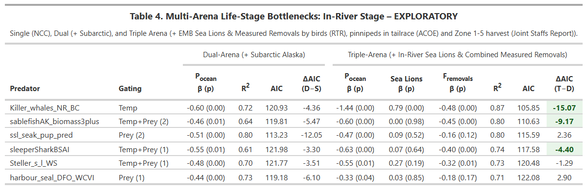
```
  
\newpage

# Objective 5: Confirmatory Structural Equation Modeling

To evaluate whether regional trophic guilds and predation complexes operate as coherent latent drivers of Chinook marine survival (SAR), we recombined the subguilds within each SEM node that had previously been evaluated one at a time. We restricted the subguild indicators to those that had some importance in the one-at-a-time analysis in objective 2 (Fig 1) ($w_i > 0.05$), and had $\le 2$ missing years over the 24-year series (1998–2021). If more than 4 indicators remained in the node (AKPrey and AKpred), we grouped them using hclust and tested each cluster separately. This step was necessary to ensure the indicators within each latent node were sufficiently correlated to justify being combined into a latent node, and to ensure we did not have too many parameters to prevent convergence.  Sub-models for each regional trophic block (NCC prey, subarctic prey, and subarctic effective predation) were pruned using backward elimination ($\alpha = 0.10$) before being integrated into a multi-stage confirmatory synthesis model.


```{r}
#| label: fig-obj5-sem-models
#| eval: true
#| fig-cap: "Confirmatory SEM path diagrams. Includes regional/trophic candidate sub-models (M1–M4) and the full multi-stage synthesis model (M5). Note that in the final figure, SAR and CPUE boxes are mislabeled and should be exchanged."
#| fig-align: center
#| fig-pos: "H"
#| out-width: "95%"
#| echo: false

# Automatically finds and includes the generated SEM diagram PNGs
sem_figs <- sort(list.files("Outputs/figures/selected_sem_plots", pattern = "^fig_.*\\.png$", full.names = TRUE))
knitr::include_graphics(sem_figs)
```


## Model Diagnostics 


```{r}
#| label: tbl-obj5-fit-summary
#| eval: true
#| tbl-cap: "Goodness-of-fit metrics, AIC, and explained variance ($R^2$) across candidate and confirmatory SEM architectures."
#| echo: false
#| message: false
#| warning: false

library(tidyverse)
library(knitr)

fit_table_path <- "Outputs/data/obj4_selected_models_fit_and_r2_summary.csv"

if (file.exists(fit_table_path)) {
  read_csv(fit_table_path, show_col_types = FALSE) %>%
    # Replace underscores with spaces so LaTeX never treats them as math subscripts
    mutate(Model_ID = gsub("_", " ", Model_ID)) %>%
    kable(
      format = "latex",
      booktabs = TRUE,
      col.names = c("Model ID", "AIC", "CFI", "SRMR", 
                    "Growth R2", "CPUE R2", "SAR R2"),
      digits = 3,
      align = c("l", rep("r", 6)),
      table.envir = "table",
      position = "H"          # Forces LaTeX to keep the table EXACTLY here
    )
}
```

\newpage


\newpage
# Modulated Predator Latent Structural Equation Models 
## In this case, DFAs in NCC Prey and NCC Predator nodes were decomposed into their original indicators so it is a true latent node rather than a combined DFA. Indicators of the latent nodes were pruned to significant factors where p was less than or equal to 0.05. Note that this was too restrictive a criterion for a confirmatory analysis, so the main effects in Peff will probably be restored.


## Candidate 1: Sablefish (Age 3+)
Final pruned structural model retaining both coastal early marine and subarctic marine stages.

```{r}
#| label: fig-obj4-sablefish
#| fig-cap: "Final pruned structural equation model: Sablefish Age 3+ Peff model (AIC = -23.22, SAR R² = 0.73)."
#| fig-align: center
#| out-width: "90%"
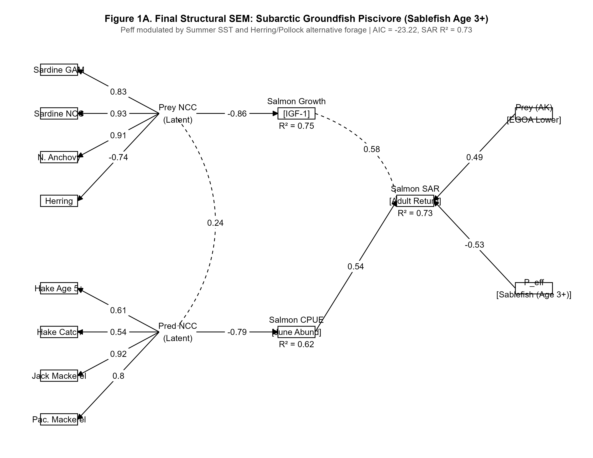
```

\newpage

## Candidate 2: Sleeper Shark
Final pruned structural model retaining top-down subarctic apex shark predation.

```{r}
#| label: fig-obj4-sleepershark
#| fig-cap: "Final pruned structural equation model: Sleeper Shark Peff model."
#| fig-align: center
#| out-width: "90%"
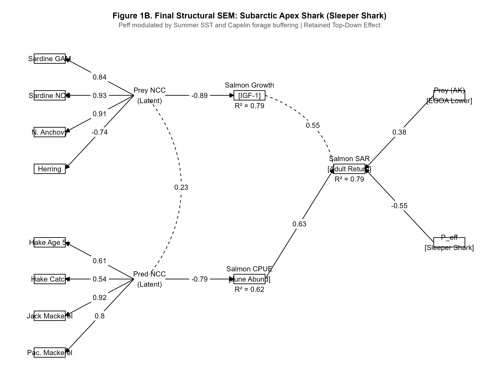
```

\newpage

## Candidate 3 / Baseline: NCC + AK lower trophic
Pruned architecture resulting when candidate subarctic marine predators drop out ($p \ge 0.05$).

```{r}
#| label: fig-obj4-baseline
#| fig-cap: "Final pruned baseline structural architecture (Coastal-only survival; AIC = -21.58, SAR R² = 0.83)."
#| fig-align: center
#| out-width: "90%"
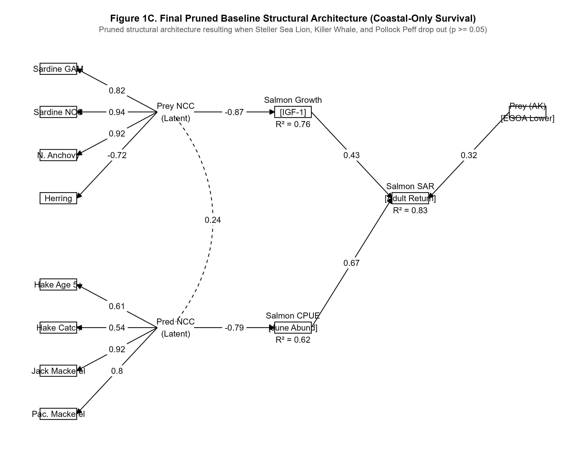
```

\newpage

# Supplementary Material

## Table S1: Full list of indicators analyzed with sources
```{r}
#| label: fig-supp-table-s1
#| fig-cap: "Supplementary Table S1. Guild and SEM Node Definitions."
#| fig-align: center
#| fig-pos: "H"
#| out-width: "95%"

# Automatically finds and includes all generated Table S1 PNG pages in numerical order
s1_files <- sort(list.files("Outputs/tables", pattern = "^obj0_table_S1_page_.*\\.png$", full.names = TRUE))
knitr::include_graphics(s1_files)
```


\newpage

## Table S2: Mean coefficient sign and proportion significant for all indicators


```{r}
#| label: fig-supp-coef_by_indicator
#| fig-cap: "Supplemental Table S2: Coefficients by indicator."
#| fig-align: center
#| fig-pos: "H"
#| out-width: "90%"
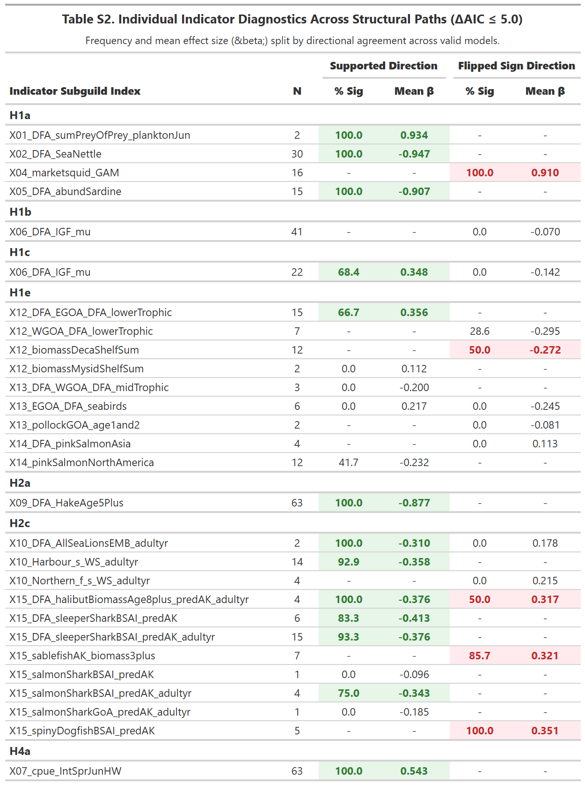
```

\newpage

## Table S3: Complete Variable Importance Across All Evaluated Indicators
Full numerical compilation of cumulative Akaike weights ($w_i$) across all candidate indicators, including those falling below the main text $\max(w_i) \ge 0.05$ plotting threshold.

```{r}
#| label: fig-supp-varimp
#| fig-cap: "Supplemental Table S3: Full compilation of relative variable importance across all candidate ecosystem indicators."
#| fig-align: center
#| fig-pos: "H"
#| out-width: "90%"
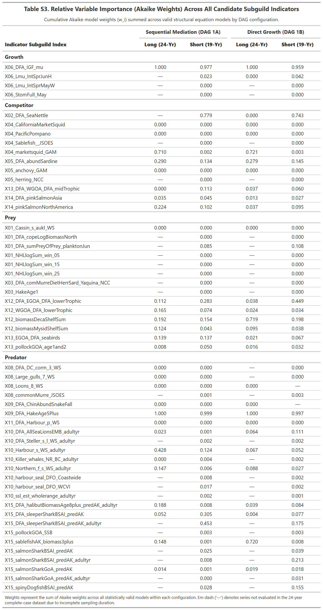
```

