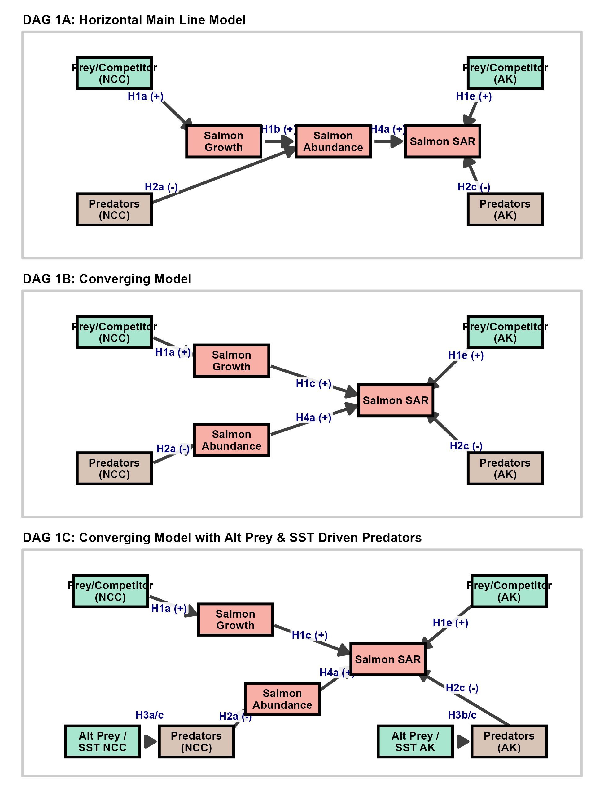
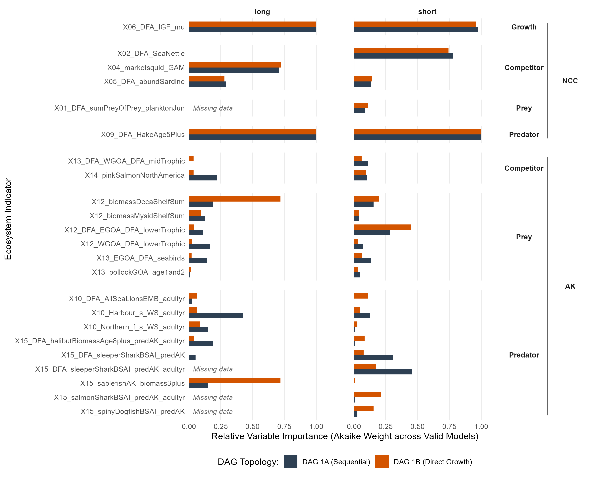

  
  \newpage

# Methods
## Table: Indicator categories (general)

```{r}
#| label: tbl-obj0-indicator_list
#| tbl-cap: "Summary of ecosystem indicator screening and subguild consolidation from raw environmental series to Structural Equation Model (SEM) latent nodes."
#| tbl-pos: "H"
#| results: asis

library(tidyverse)
library(knitr)

path <- "C:/Users/Lisa.Crozier/Documents/Marine survival/SEM-DFO-LisaXP/Rcode_for_paper/Routput_for_paper/Supplements/guilds.csv"

doug_guilds <- read.csv(path, stringsAsFactors = FALSE, row.names = NULL, na.strings = c("", "NA")) %>%
  filter(!is.na(Lisa_15Oct2026)) %>%
  select(ID, SEMnode, region, subregion, Lisa_21oct26, indicator, source_short, source_raw) %>%
  arrange(Lisa_21oct26)

indicator_table_data <- doug_guilds %>%
  filter(SEMnode %in% c("PreyNCC", "PredNCC", "PreyAK", "PredAK", "Growth", "Abundance", "SAR")) %>%
  group_by(SEMnode) %>%
  summarise(
    N_Screened = sum(!is.na(Lisa_21oct26) & Lisa_21oct26 != ""),
    # Use \newline inside m{} columns and escape underscores for LaTeX
    Subguild_Codes = paste(
      gsub("_", "\\\\_", unique(Lisa_21oct26[Lisa_21oct26 != "" & !is.na(Lisa_21oct26)])),
      collapse = " \\newline "
    ),
    .groups = "drop"
  ) %>%
  mutate(
    SEM_Node_Full = case_when(
      SEMnode == "PreyNCC"   ~ "\\textbf{Northern California Current} \\newline (NCC Prey)",
      SEMnode == "PredNCC"   ~ "\\textbf{Northern California Current} \\newline (NCC Predators)",
      SEMnode == "PreyAK"    ~ "\\textbf{BC Coast, Gulf of Alaska} \\newline (AK Prey)",
      SEMnode == "PredAK"    ~ "\\textbf{BC Coast, Gulf of Alaska} \\newline (AK Predators)",
      SEMnode == "Growth"    ~ "\\textbf{Salmon Condition}\\newline (Growth)",
      SEMnode == "Abundance" ~ "\\textbf{Early Marine Survival} (CPUE)",
      SEMnode == "SAR"       ~ "\\textbf{Smolt to Adult \\newline Survival}  (SAR)",
      TRUE                   ~ SEMnode
    ),
    Subguild_Names = case_when(
      SEMnode == "PreyNCC"   ~ "Zooplankton (Newport, WA & WCVI surveys), Krill, Forage Fish, Competitors (Juv Sablefish, Market squid, Jellies)",
      SEMnode == "PredNCC"   ~ "Piscivorous Seabirds, Nearshore/Surface-feeding Groundfish, Marine Mammals",
      SEMnode == "PreyAK"    ~ "Lower & Mid-Trophic indices (Ferris et al, EGOA/WGOA), WCVI Krill, Forage Fish & Seabirds, Pink Salmon Competitors",
      SEMnode == "PredAK"    ~ "Predatory Groundfish & Sharks (Dogfish, Sleeper & Salmon Sharks), Marine Mammals",
      SEMnode == "Growth"    ~ "Juvenile Salmon IGF-1 Condition & Stomach Fullness",
      SEMnode == "Abundance" ~ "Juvenile Salmon CPUE Indices",
      SEMnode == "SAR"       ~ "Adult Returns of Pit-tagged Smolts",
      TRUE                   ~ ""
    ),
    # Escape ampersands so LaTeX doesn't treat them as column breaks
    Subguild_Names = gsub("&", "\\\\&", Subguild_Names),
    order = match(SEMnode, c("PreyNCC", "PredNCC", "PreyAK", "PredAK", "Growth", "Abundance", "SAR"))
  ) %>%
  arrange(order) %>%
  select(SEM_Node_Full, Subguild_Names, N_Screened, Subguild_Codes)

# Build the raw LaTeX tabular with m{} vertical centering and \midrule between rows
tbl_latex <- indicator_table_data %>%
  kable(
    format = "latex",
    booktabs = TRUE,
    escape = FALSE,
    linesep = "\\midrule",
    col.names = c(
      "\\textbf{SEM Node}",
      "\\textbf{Target Guilds}",
      "\\textbf{Indicator Count}",
      "\\textbf{SEM Subguild Codes (Lisa\\_21oct26)}"
    ),
    align = c("l", "l", "c", "l")
  )

# Replace kable's default {llcl} column spec with vertically-centered m{} widths
# (Total width = 1.55 + 2.35 + 0.70 + 1.50 = 6.10 in, fitting cleanly inside 6.5 in margins)
tbl_latex <- sub(
  "\\{llcl\\}",
  "{>{\\\\raggedright\\\\arraybackslash}m{1.55in} >{\\\\raggedright\\\\arraybackslash}m{2.35in} >{\\\\centering\\\\arraybackslash}m{0.70in} >{\\\\raggedright\\\\arraybackslash}m{1.50in}}",
  tbl_latex
)

# Remove the extra \midrule right before \bottomrule so the bottom border isn't doubled
tbl_latex <- sub("\\\\midrule\\s*\\\\bottomrule", "\\\\bottomrule", tbl_latex)

# Optional: slightly smaller font so multi-line subguild lists breathe cleanly
cat("\\small\n", tbl_latex, "\n\\normalsize\n", sep = "")

```

\newpage

## Figure: DAGS

```{r}
#| label: fig-obj0-dag1ABC
#| fig-cap: "DAGs used in analysis."
#| fig-align: center
#| fig-pos: "H"
#| out-width: "80%"

```
\newpage
## Table: Hypotheses

```{r}
#| label: tbl-obj0-hypotheses
#| tbl-cap: "Proposed ecological and regional hypotheses categorized by trophic control (H1–H3) and regional life-stage bottlenecks (H4), as labeled in Figure 1."
#| tbl-pos: "H"
#| results: asis

library(tidyverse)
library(knitr)

# 1. Build Hypotheses Data Frame (Primary_Reference removed)
hypotheses_df <- tribble(
  ~Code, ~Category, ~Ecological_Mechanism, ~Target_Path, ~Expected_Sign, ~Evaluated_DAGs,
  
  # Category 1: Bottom-Up
  "H1a", "H1: Bottom-up", "Early marine prey availability promotes juvenile growth", "PreyNCC -> Growth", "+", "DAG1A, DAG1B",
  "H1b", "H1: Bottom-up", "Early marine growth enhances early ocean abundance (CPUE)", "Growth -> CPUE", "+", "DAG1A",
  "H1c", "H1: Bottom-up", "Early marine growth directly increases smolt-to-adult survival", "Growth -> SAR", "+", "DAG1B",
  "H1e", "H1: Bottom-up", "Subarctic marine productivity enhances late marine survival", "PreyAK -> SAR", "+", "DAG1A, DAG1B",
  
  # Category 2: Top-Down
  "H2a", "H2: Top-down", "Early ocean predator pressure reduces juvenile abundance", "PredNCC -> CPUE", "-", "DAG1A, DAG1B",
  "H2c", "H2: Top-down", "Late marine predation acts as a bottleneck on adult survival", "PredAK -> SAR", "-", "DAG1A, DAG1B",
  
  # Category 3: Indirect & Moderated
  "H3a", "H3: Top-down Moderated", "Alternate prey buffer early juvenile salmon from NCC predators", "PredNCC * AltPreyNCC -> Abundance", "+", "DAG1D (Two-Stage)",
  "H3b", "H3: Top-down Moderated", "Buffer prey induce functional switching by sea lions/sharks", "PredAK * AltPreyAK -> SAR", "+", "DAG1D (Two-Stage)",
  "H3c", "H3: Top-down Moderated", "Thermal conditions alter spatial overlap and predation intensity", "Pred * SST -> Survival", "+/-", "DAG1D (Two-Stage)",
  
  # Category 4: Regional Life-Stage Dominance
  "H4a", "H4: Regional Bottleneck", "Early ocean residence (NCC) sets survival trajectory prior to AK stage", "CPUE -> SAR", "+ (Rel. Magnitude)", "DAG1A, DAG1B, DAG1D"
) %>%
  mutate(
    # Format arrows cleanly as LaTeX math arrows and escape * / & if any appear
    Target_Path = gsub("->", "$\\\\rightarrow$", Target_Path),
    Target_Path = gsub("\\*", "$\\\\times$", Target_Path),
    Expected_Sign = gsub("\\+/-", "$\\\\pm$", Expected_Sign)
  )

# 2. Insert full-width bold Category subheader rows (mimicking gt's groupname_col)
categories <- unique(hypotheses_df$Category)
grouped_rows <- map_dfr(categories, function(cat_name) {
  header_row <- tibble(
    Code = paste0("\\multicolumn{5}{l}{\\textbf{", cat_name, "}}"),
    Ecological_Mechanism = NA_character_,
    Target_Path = NA_character_,
    Expected_Sign = NA_character_,
    Evaluated_DAGs = NA_character_
  )
  body_rows <- hypotheses_df %>%
    filter(Category == cat_name) %>%
    select(-Category)
  bind_rows(header_row, body_rows)
})

# 3. Build raw LaTeX tabular
tbl_latex <- grouped_rows %>%
  kable(
    format = "latex",
    booktabs = TRUE,
    escape = FALSE,
    linesep = "\\midrule",
    col.names = c(
      "\\textbf{Code}",
      "\\textbf{Ecological Mechanism}",
      "\\textbf{Target Structural Path}",
      "\\textbf{Expected Sign}",
      "\\textbf{Target DAGs}"
    ),
    align = c("c", "l", "l", "c", "c")
  )

# Clean up the \multicolumn rows (kable prints literal "NA" into the remaining 4 columns)
tbl_latex <- gsub(
    "(\\\\multicolumn\\{5\\}\\{l\\}\\{\\\\textbf\\{.*?\\}\\})\\s*&\\s*NA\\s*&\\s*NA\\s*&\\s*NA\\s*&\\s*NA\\s*\\\\\\\\",
      "\\1 \\\\\\\\",
tbl_latex
)

# Apply vertically-centered m{} column widths (Total = 0.45 + 2.25 + 1.45 + 0.85 + 1.15 = 6.15 in)
tbl_latex <- sub(
  "\\{cllcc\\}",
  "{>{\\\\centering\\\\arraybackslash}m{0.45in} >{\\\\raggedright\\\\arraybackslash}m{2.25in} >{\\\\raggedright\\\\arraybackslash}m{1.45in} >{\\\\centering\\\\arraybackslash}m{0.85in} >{\\\\centering\\\\arraybackslash}m{1.15in}}",
  tbl_latex
)

# Remove duplicate \midrule right before \bottomrule
tbl_latex <- sub("\\\\midrule\\s*\\\\bottomrule", "\\\\bottomrule", tbl_latex)

cat("\\small\n", tbl_latex, "\n\\normalsize\n", sep = "")
```
\newpage
# Objective 1: Ecosystem Drivers Supported Via Variable Importance

Overview
Model selection across candidate single-indicator structural equation models (SEMs) evaluated the relative influence of coastal Northern California Current (NCC) and Gulf of Alaska (AK) drivers on early marine survival (SAR). Multi-model inference via Akaike weights ($w_i$) was calculated across all statistically valid models ($p(\chi^2) \ge 0.05$, $\text{CFI} \ge 0.80$, $\text{SRMR} \le 0.10$, $\text{AGFI} \ge 0.80$) following baseline exclusions (`sablefishAK_biomass4plus` and `pollockGOA_SSB_lag1`).

## Figure: Relative Variable Importance across Ecosystem Indicators
Relative variable importance ($w_i$) across all ecosystem indicators meeting the $\max(w_i) \ge 0.05$ threshold, comparing sequential mediation (DAG 1A) and direct growth mediation (DAG 1B) topologies across the 24-year complete dataset and 19-year expanded series.

```{r}
#| label: fig-obj2-importance
#| fig-cap: "Relative variable importance (Akaike weights) across candidate functional ecosystem indicators."
#| fig-align: center
#| out-width: "100%"

```

\newpage

#Objective 2: Test hypotheses


## Table: Consistency of coefficient sign and significance with hypothesized mechanisms

```{r}
#| label: tbl-obj1-hypotests
#| tbl-cap: 'Evaluation of structural path hypotheses across plausible models ($\Delta\text{AIC} \le 5.0$).'
#| tbl-pos: "H"
#| results: asis

library(tidyverse)
library(knitr)

tbl_latex <- read_csv("Outputs/data/obj1_table2_display_main.csv", show_col_types = FALSE) %>%
  kable(
    format = "latex",
    booktabs = TRUE,
    escape = FALSE,
    linesep = r"(\midrule)",
    col.names = c(
      r"(\textbf{Code})", r"(\textbf{Structural Path})", r"(\textbf{Expected})",
      r"(\textbf{Long (24-Yr)})", r"(\textbf{Short (19-Yr)})",
      r"(\textbf{Long (24-Yr)})", r"(\textbf{Short (19-Yr)})"
    ),
    align = c("c", "l", "c", "c", "c", "c", "c")
  )

# Fixed widths so 3-line cells center vertically and fit within 6.5in
tbl_latex <- sub(
  r"({clccccc})",
  r"({>{\centering\arraybackslash}m{0.35in} >{\raggedright\arraybackslash}m{1.15in} >{\centering\arraybackslash}m{0.80in} >{\centering\arraybackslash}m{0.82in} >{\centering\arraybackslash}m{0.82in} >{\centering\arraybackslash}m{0.82in} >{\centering\arraybackslash}m{0.82in}})",
  tbl_latex,
  fixed = TRUE
)

spanner <- r"(\toprule
 &  &  & \multicolumn{2}{c}{\textbf{Sequential Mediation (DAG 1A)}} & \multicolumn{2}{c}{\textbf{Direct Growth (DAG 1B)}} \\
\cmidrule(lr){4-5} \cmidrule(lr){6-7}
)"
tbl_latex <- sub(r"(\toprule)", spanner, tbl_latex, fixed = TRUE)
tbl_latex <- sub(r"(\midrule\s*\\bottomrule)", r"(\bottomrule)", tbl_latex)

cat(
  r"(\begingroup
\scriptsize
\setlength{\tabcolsep}{3pt}
\renewcommand{\arraystretch}{1.2}
)",
  tbl_latex,
  r"(
\vspace{4pt}
\begin{minipage}{\linewidth}
\footnotesize\textit{Note:} Evaluated across valid models with $\Delta\text{AIC} \le 5.0$ relative to the top valid model per configuration. \textbf{Supported}: $\ge 50\%$ significant ($p < 0.05$) in hypothesized direction; \textbf{Flipped Sign}: $\ge 50\%$ significant in counter-intuitive direction; \textbf{NS}: $< 50\%$ significant.
\end{minipage}
\endgroup
)",
  sep = ""
)
```

\newpage
# Objective 3: Direct vs. Modulated Predation Topologies

## Overview
To address counter-intuitive positive relationships between raw predator abundance and salmon survival, candidate predators were evaluated under an effective predation framework ($P_{\text{eff}}$):
$$P_{\text{eff}} = P_{\text{norm}} \cdot \text{SST}_{\text{gate}} \cdot (1 - \text{AltPrey}_{\text{gate}})$$
where thermal spatial overlap ($\text{SST}$) and alternative forage buffering ($\text{AltPrey}$) were scaled with a 0.2 baseline floor to prevent complete zero-multiplication.

## Table: Effective Predation ($P_{\text{eff}}$) Model Comparisons

```{r}
#| label: tbl-obj3-peff
#| tbl-cap: 'Comparison of nominal predator biomass models versus top-ranked modulated $P_{\text{eff}}$ formulations across the 24-year series (1998--2021).'
#| tbl-pos: "H"
#| results: asis

library(tidyverse)
library(knitr)

tbl_latex <- read_csv("Outputs/data/obj3_table_display_24yr.csv", show_col_types = FALSE) %>%
  kable(
    format = "latex",
    booktabs = TRUE,
    escape = FALSE,
    linesep = r"(\addlinespace[2pt])",
    col.names = c(
      r"(\textbf{Predator})", r"(\textbf{$\beta$ ($p$)})", r"(\textbf{AIC})",
      r"(\textbf{Mechanism})", r"(\textbf{Alt. Prey Pool})",
      r"(\textbf{$\beta$ ($p$)})", r"(\textbf{AIC})", r"(\textbf{$\Delta$AIC})"
    ),
    align = c("l", "c", "r", "l", "l", "c", "r", "r")
  )

# Wrap Predator (1.20in) and Alt. Prey Pool (1.35in) so the 8 columns fit within 6.5in
tbl_latex <- sub(
  r"({lcrllcrr})",
  r"({>{\raggedright\arraybackslash}m{1.20in} c r l >{\raggedright\arraybackslash}m{1.35in} c r r})",
  tbl_latex,
  fixed = TRUE
)

# Spanned headers carry "Nominal (Base)" and "Effective Predation (Peff)" once
spanner <- r"(\toprule
 & \multicolumn{2}{c}{\textbf{Nominal (Base)}} & \multicolumn{5}{c}{\textbf{Effective Predation ($P_{\text{eff}}$)}} \\
\cmidrule(lr){2-3} \cmidrule(lr){4-8}
)"
tbl_latex <- sub(r"(\toprule)", spanner, tbl_latex, fixed = TRUE)

cat(
  r"(\begingroup
\scriptsize
\setlength{\tabcolsep}{3pt}
\renewcommand{\arraystretch}{1.15}
)",
  tbl_latex,
  r"(
\vspace{4pt}
\begin{minipage}{\linewidth}
\footnotesize\textit{Note:} $P_{\text{eff}}$ attenuates predation via temperature gating ($P \times \text{SST}$) and/or alternative prey buffering ($P \times [1 - \text{AltPrey}]$). Bold green values indicate statistically significant negative top-down impacts ($\beta < 0$, $p \le 0.05$) or model improvements ($\Delta\text{AIC} < 0$). Bold red values in Nominal $\beta$ ($p$) indicate counter-intuitive positive nominal relationships ($\beta > 0$, $p < 0.20$).
\end{minipage}
\endgroup
)",
  sep = ""
)

```
\newpage

## Table: Model Diagnostics

```{r}
#| label: tbl-obj5-fit-summary
#| tbl-cap: "Goodness-of-fit metrics, AIC, and explained variance ($R^2$) across candidate and confirmatory SEM architectures."
#| tbl-pos: "H"

library(tidyverse)
library(knitr)

fit_table_path <- "Outputs/data/obj4_selected_models_fit_and_r2_summary.csv"

if (file.exists(fit_table_path)) {
  read_csv(fit_table_path, show_col_types = FALSE) %>%
    mutate(Model_ID = gsub("_", " ", Model_ID)) %>%
    kable(
      booktabs = TRUE,
      col.names = c("Model ID", "AIC", "CFI", "SRMR", 
                    "Growth $R^2$", "CPUE $R^2$", "SAR $R^2$"),
      digits = 3,
      align = c("l", rep("r", 6)),
      escape = FALSE
    )
}
```

\newpage


# Supplementary Material

## Table S2:  Resolution of topology --early vs late growth effects

Relative variable importance ($w_i$) across all ecosystem indicators meeting the $\max(w_i) \ge 0.05$ threshold, comparing sequential mediation (DAG 1A) and direct growth mediation (DAG 1B) topologies across the 24-year complete dataset and 19-year expanded series.

```{r}
#| label: tbl-obj1-dag1AvB
#| tbl-cap: "Goodness-of-fit and information-theoretic comparison of top 10 models in DAG 1A vs. DAG 1B."
#| tbl-pos: "H"
#| results: asis

library(tidyverse)
library(knitr)

# 1. Directory Setup (Long & Short Sweeps)
base_sweep_dir <- "C:/Users/Lisa.Crozier/Documents/Marine survival/Doug results/2026_10_23_SEM/shiftLisa_1_Lisa_22oct26"

res_1a_long_raw  <- read.csv(file.path(base_sweep_dir, "DAG1A_long",  "SEMresultsByClus.csv"), stringsAsFactors = FALSE)
res_1b_long_raw  <- read.csv(file.path(base_sweep_dir, "DAG1B_long",  "SEMresultsByClus.csv"), stringsAsFactors = FALSE)
res_1a_short_raw <- read.csv(file.path(base_sweep_dir, "DAG1A_short", "SEMresultsByClus.csv"), stringsAsFactors = FALSE)
res_1b_short_raw <- read.csv(file.path(base_sweep_dir, "DAG1B_short", "SEMresultsByClus.csv"), stringsAsFactors = FALSE)

# 2. Filter Valid Models (Liberal Thresholds)
filter_valid_sem <- function(df) {
  df %>%
    filter(
      !is.na(AIC),
      p_Chi2 >= 0.05,
      CFI    >= 0.80,
      SRMR   <= 0.10,
      AGFI   >= 0.80
    ) %>%
    arrange(AIC)
}

valid_1a_long  <- filter_valid_sem(res_1a_long_raw)
valid_1b_long  <- filter_valid_sem(res_1b_long_raw)
valid_1a_short <- filter_valid_sem(res_1a_short_raw)
valid_1b_short <- filter_valid_sem(res_1b_short_raw)

# 3. Build Formatted Panel Data Frame (Pre-formatted strings preserve trailing zeros)
prep_panel_df <- function(valid_a, valid_b, panel_name, top_n = 10) {
  top_a <- valid_a %>% slice_head(n = top_n)
  top_b <- valid_b %>% slice_head(n = top_n)
  
  tibble(
    Panel         = panel_name,
    Rank          = as.character(1:top_n),
    `1A_AIC`      = sprintf("%.2f", top_a$AIC),
    `1A_CFI`      = sprintf("%.3f", top_a$CFI),
    `1A_SRMR`     = sprintf("%.3f", top_a$SRMR),
    `1A_AGFI`     = sprintf("%.3f", top_a$AGFI),
    `1A_p_Chi2`   = sprintf("%.3f", top_a$p_Chi2),
    `1B_AIC`      = sprintf("%.2f", top_b$AIC),
    `1B_CFI`      = sprintf("%.3f", top_b$CFI),
    `1B_SRMR`     = sprintf("%.3f", top_b$SRMR),
    `1B_AGFI`     = sprintf("%.3f", top_b$AGFI),
    `1B_p_Chi2`   = sprintf("%.3f", top_b$p_Chi2),
    `Delta_AIC`   = sprintf("%.2f", top_a$AIC - top_b$AIC)
  )
}

df_long_panel  <- prep_panel_df(valid_1a_long,  valid_1b_long,  "Panel A: Long / 24-Year Sweep (1998--2021)")
df_short_panel <- prep_panel_df(valid_1a_short, valid_1b_short, "Panel B: Short / 19-Year Sweep (2003--2021)")
stacked_df     <- bind_rows(df_long_panel, df_short_panel)

# 4. Insert full-width bold Panel subheader rows
options(knitr.kable.NA = "")
panels <- unique(stacked_df$Panel)

grouped_rows <- map_dfr(panels, function(p_name) {
  header_row <- tibble(
    Rank = paste0("\\multicolumn{12}{l}{\\textbf{", p_name, "}}")
  )
  body_rows <- stacked_df %>%
    filter(Panel == p_name) %>%
    select(-Panel)
  bind_rows(header_row, body_rows)
})

# 5. Build raw LaTeX tabular
tbl_latex <- grouped_rows %>%
  kable(
    format = "latex",
    booktabs = TRUE,
    escape = FALSE,
    linesep = "",
    col.names = c(
      "\\textbf{Rank}",
      "\\textbf{AIC}", "\\textbf{CFI}", "\\textbf{SRMR}", "\\textbf{AGFI}", "\\textbf{$p(\\chi^2)$}",
      "\\textbf{AIC}", "\\textbf{CFI}", "\\textbf{SRMR}", "\\textbf{AGFI}", "\\textbf{$p(\\chi^2)$}",
      "\\textbf{$\\Delta$AIC}"
    ),
    align = c("c", rep("r", 11))
  )

# Insert spanned group headers (DAG 1A and DAG 1B) right after \toprule
spanner_header <- paste0(
  "\\\\toprule\n",
  " & \\\\multicolumn{5}{c}{\\\\textbf{DAG 1A (Sequential Mediation)}} & ",
  "\\\\multicolumn{5}{c}{\\\\textbf{DAG 1B (Direct Growth)}} & \\\\textbf{(1A $-$ 1B)} \\\\\\\\\n",
  "\\\\cmidrule(lr){2-6} \\\\cmidrule(lr){7-11}\n"
)
tbl_latex <- sub("\\\\toprule", spanner_header, tbl_latex)

# Clean up the \multicolumn Panel rows and add subtle horizontal rules around them
tbl_latex <- gsub(
  "(\\\\multicolumn\\{12\\}\\{l\\}\\{\\\\textbf\\{.*?\\}\\})(\\s*&)*\\s*\\\\\\\\",
  "\\\\midrule\n\\1 \\\\\\\\\n\\\\midrule",
  tbl_latex
)
# Avoid double \midrule right under the header row
tbl_latex <- sub("\\\\midrule\\s*\\\\midrule", "\\\\midrule", tbl_latex)

# 6. Print with compact spacing + source note underneath
cat(
  "\\begingroup\n",
  "\\scriptsize\n",
  "\\setlength{\\tabcolsep}{3.2pt}\n",
  "\\renewcommand{\\arraystretch}{1.15}\n",
  tbl_latex, "\n",
  "\\vspace{4pt}\n",
  "\\begin{minipage}{\\linewidth}\n",
  "\\footnotesize\\textit{Note:} Top 10 candidate models filtered using liberal fit criteria: $p(\\chi^2) \\ge 0.05$, $\\text{CFI} \\ge 0.80$, $\\text{SRMR} \\le 0.10$, $\\text{AGFI} \\ge 0.80$. Positive $\\Delta$AIC values favor the direct growth topology of DAG 1B.\n",
  "\\end{minipage}\n",
  "\\endgroup\n",
  sep = ""
)
```

\newpage


##Table S3: Individual indicator signs and significance
```{r}
#| label: tbl-obj1-hypotests-supp
#| tbl-cap: 'Individual indicator diagnostics across structural paths ($\Delta\text{AIC} \le 5.0$), showing frequency and mean effect size ($\beta$) split by directional agreement.'
#| tbl-pos: "H"
#| results: asis

library(tidyverse)
library(knitr)

options(knitr.kable.NA = "")

tbl_latex <- read_csv("Outputs/data/obj1_tableS2_display_supp.csv", show_col_types = FALSE) %>%
  kable(
    format = "latex",
    booktabs = TRUE,
    longtable = TRUE,
    escape = FALSE,
    linesep = "",
    col.names = c(
      r"(\textbf{Indicator Subguild Index})", r"(\textbf{N})",
      r"(\textbf{\% Sig})", r"(\textbf{Mean $\beta$})",
      r"(\textbf{\% Sig})", r"(\textbf{Mean $\beta$})"
    ),
    align = c("l", "c", "r", "r", "r", "r")
  )

# Clean up \multicolumn group rows and add subtle horizontal dividers
tbl_latex <- gsub(
  r"((\\multicolumn\{6\}\{l\}\{\\textbf\{.*?\}\})(\s*&)*\s*\\\\)",
  "\\\\midrule\n\\1 \\\\\\\\\n\\\\midrule",
  tbl_latex
)

spanner <- r"(\toprule
 &  & \multicolumn{2}{c}{\textbf{Supported Direction}} & \multicolumn{2}{c}{\textbf{Flipped Sign Direction}} \\
\cmidrule(lr){3-4} \cmidrule(lr){5-6}
)"
tbl_latex <- sub(r"(\toprule)", spanner, tbl_latex, fixed = TRUE)
tbl_latex <- sub(r"(\midrule\s*\\midrule)", r"(\midrule)", tbl_latex)

cat(
  r"(\begingroup
\scriptsize
\setlength{\tabcolsep}{4pt}
\renewcommand{\arraystretch}{1.15}
)",
  tbl_latex,
  r"(
\vspace{4pt}
\begin{minipage}{\linewidth}
\footnotesize\textit{Note:} Bold green values indicate indicators with $\ge 50\%$ significant paths ($p < 0.05$) in the hypothesized direction; bold red values indicate $\ge 50\%$ significant paths in the opposite direction.
\end{minipage}
\endgroup
)",
  sep = ""
)

```
\newpage
## Table S4: Effective Predation ($P_{\text{eff}}$) Model Comparisons (19-Year Series)

```{r}
#| label: tbl-obj3-peff-19yr
#| tbl-cap: 'Comparison of nominal predator biomass models versus top-ranked modulated $P_{\text{eff}}$ formulations across the expanded 19-year series (2003--2021).'
#| tbl-pos: "H"
#| results: asis

library(tidyverse)
library(knitr)

tbl_latex <- read_csv("Outputs/data/obj3_table_display_19yr.csv", show_col_types = FALSE) %>%
  kable(
    format = "latex",
    booktabs = TRUE,
    escape = FALSE,
    linesep = r"(\addlinespace[2pt])",
    col.names = c(
      r"(\textbf{Predator})", r"(\textbf{$\beta$ ($p$)})", r"(\textbf{AIC})",
      r"(\textbf{Mechanism})", r"(\textbf{Alt. Prey Pool})",
      r"(\textbf{$\beta$ ($p$)})", r"(\textbf{AIC})", r"(\textbf{$\Delta$AIC})"
    ),
    align = c("l", "c", "r", "l", "l", "c", "r", "r")
  )

# Wrap Predator (1.20in) and Alt. Prey Pool (1.35in) so the 8 columns fit within 6.5in
tbl_latex <- sub(
  r"({lcrllcrr})",
  r"({>{\raggedright\arraybackslash}m{1.20in} c r l >{\raggedright\arraybackslash}m{1.35in} c r r})",
  tbl_latex,
  fixed = TRUE
)

# Spanned headers carry "Nominal (Base)" and "Effective Predation (Peff)" once
spanner <- r"(\toprule
 & \multicolumn{2}{c}{\textbf{Nominal (Base)}} & \multicolumn{5}{c}{\textbf{Effective Predation ($P_{\text{eff}}$)}} \\
\cmidrule(lr){2-3} \cmidrule(lr){4-8}
)"
tbl_latex <- sub(r"(\toprule)", spanner, tbl_latex, fixed = TRUE)

cat(
  r"(\begingroup
\scriptsize
\setlength{\tabcolsep}{3pt}
\renewcommand{\arraystretch}{1.15}
)",
  tbl_latex,
  r"(
\vspace{4pt}
\begin{minipage}{\linewidth}
\footnotesize\textit{Note:} $P_{\text{eff}}$ attenuates predation via temperature gating ($P \times \text{SST}$) and/or alternative prey buffering ($P \times [1 - \text{AltPrey}]$). Bold green values indicate statistically significant negative top-down impacts ($\beta < 0$, $p \le 0.05$) or model improvements ($\Delta\text{AIC} < 0$). Bold red values in Nominal $\beta$ ($p$) indicate counter-intuitive positive nominal relationships ($\beta > 0$, $p < 0.20$).
\end{minipage}
\endgroup
)",
  sep = ""
)
```