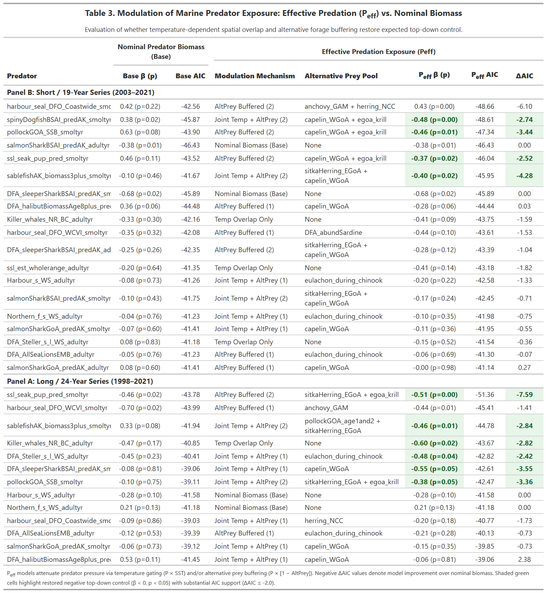

  
  \newpage

# Variable Importance and Selection

## Variable Importance Barchart (dAIC < 3)

```{r}
#| fig-align: center
#| out-width: "100%"
knitr::include_graphics("Routput_for_paper/figures/DAG1A_DAG1B_importance_barchart_dAIC3_allvars.pdf")
```

\newpage

# Pruned Models

## Final 4 Pruned Models (2x2 Grid)

```{r}
#| fig-align: center
#| out-width: "100%"
knitr::include_graphics("Routput_for_paper/figures/DAG1B_Final_4_Pruned_Models_2x2.pdf")
```

\newpage

# Candidate Models

## Candidate Models DAG 1B (24-Year Series)

```{r}
#| fig-align: center
#| out-width: "100%"
knitr::include_graphics("Routput_for_paper/figures/Peff/Candidate_Models_DAG1B_24yr.pdf")
```

# Objective 3: Direct vs. Modulated Predation Topologies

## Table 3: Effective Predation (Peff) Model Selection

```{r}
#| fig-align: center
#| out-width: "90%"

```